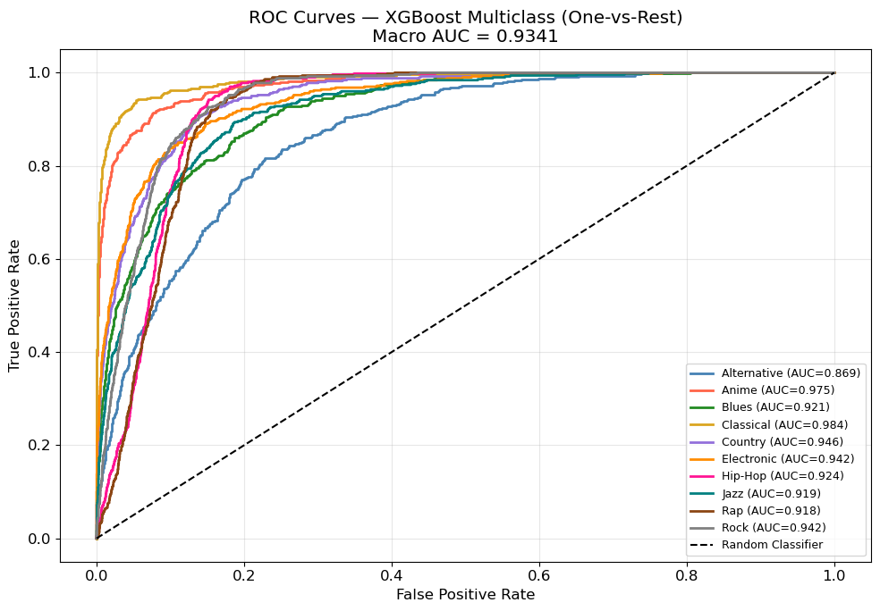
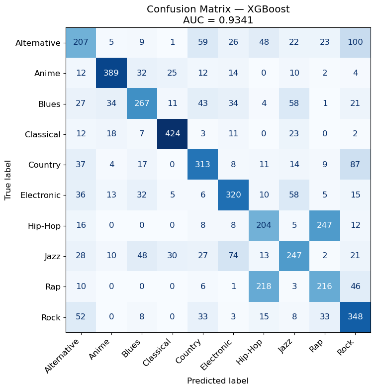
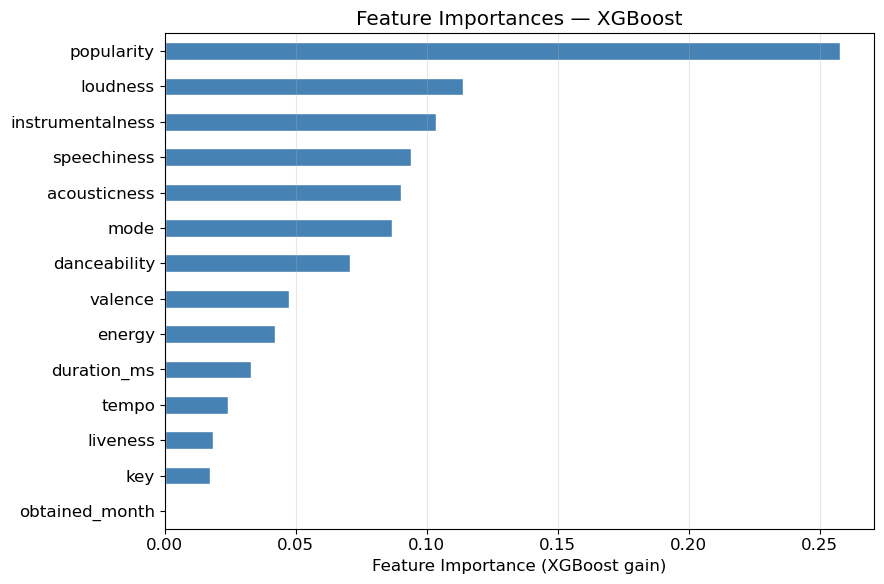
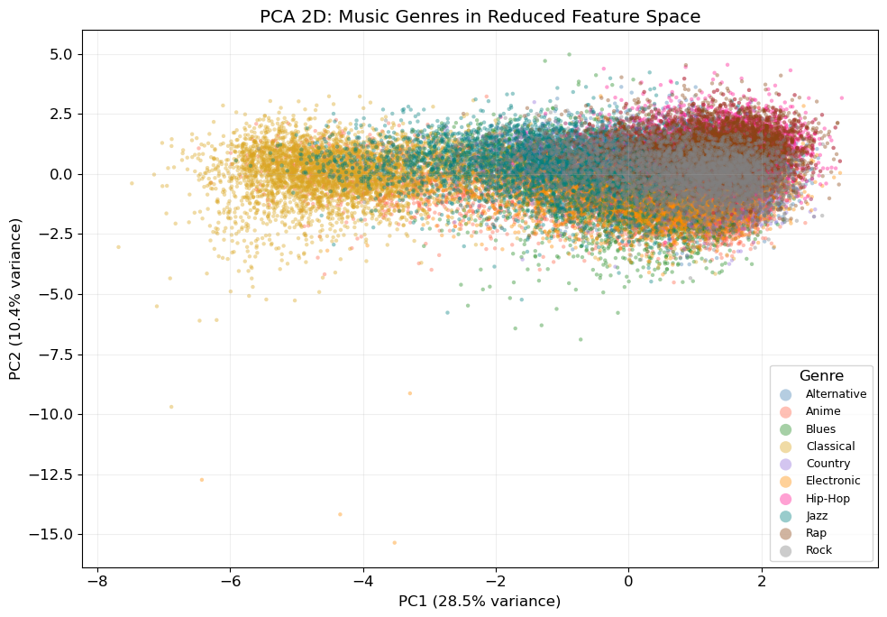

# Spotify Genre Classifier

**Predicting a song's genre from its Spotify audio features with XGBoost, across 50,000 songs and 10 genres.**

  

| Metric | Result |
|---|---|
| Macro one-vs-rest AUC | **0.9326** |
| Test accuracy | 57% (10 classes; random baseline = 10%) |
| Macro F1 | 0.57 |
| Trees before early stopping | 149 |

---

## Overview

Spotify describes every track with audio features such as tempo, energy, loudness, and speechiness. This project asks: **how well can those features alone predict a song's genre?**

I built a multiclass classifier on ~50,000 songs evenly split across 10 genres (5,000 each), with a preprocessing pipeline designed so that no information from the test set leaks into training.

## Data

- **Source:** [Prediction of Music Genre (Kaggle)](https://www.kaggle.com/vicsuperman/prediction-of-music-genre)
- **Size:** 50,005 rows × 18 columns; 10 balanced genres
- **Genres:** Alternative, Anime, Blues, Classical, Country, Electronic, Hip-Hop, Jazz, Rap, Rock

The dataset is not included in this repo. To run the project, download the CSV from Kaggle and place it in `data/`.

## Approach

### 1. Data cleaning
- Dropped 5 fully empty rows.
- `duration_ms` used `-1` as a placeholder for missing data, so those values were treated as missing.
- `tempo` was stored as text, so it was converted to numeric.
- `key` (musical notation) was encoded as numbers, and `mode` (Major/Minor) as 1/0.
- `obtained_date` was reduced to the month number.

### 2. Leakage-free preprocessing
- Remaining missing values in `duration_ms` (4,939) and `tempo` (4,980) were filled with the **median computed on the training set only**.
- All features were standardized using **training-set statistics only**.
- A 5% validation slice (2,250 rows) was carved from the training set with a seeded random permutation and used only for early stopping. The test set was never touched during training.

### 3. Model: XGBoost
XGBoost was chosen because it:
- handles multiclass classification natively,
- is robust to the non-normal distributions typical of audio features, and
- supports early stopping to prevent overfitting.

Settings: `tree_method='hist'` for memory efficiency, and 80% row and column subsampling per tree as regularization. Training stopped early at **149 trees**.

### 4. Visualization: PCA
PCA on the standardized training features gives a 2D view of the genre structure.

## Results

### Per-genre performance
| Easiest to classify | Hardest to classify |
|---|---|
| Classical: AUC 0.985 (421/500 correct) | Alternative: AUC 0.868 (201/500 correct) |
| Anime: AUC 0.976 (389/500 correct) | Hip-Hop (185/500) and Rap (194/500), most often confused with each other |




### What drives the predictions
| Feature | Importance |
|---|---|
| Popularity | 0.269 |
| Loudness | 0.114 |
| Instrumentalness | 0.101 |
| Speechiness | 0.088 |
| Mode | 0.081 |



### Genre structure in 2D
PC1 and PC2 explain 28.47% and 10.40% of the variance (38.87% total). Classical separates toward the left, while Hip-Hop, Rap, and Alternative overlap heavily.



## Key findings

- **Popularity is the strongest signal, not sound.** It likely captures genre-specific listener and streaming behavior. Niche genres like Classical and Anime have distinctive popularity profiles, which makes them easier to separate.
- **Among audio features, loudness and instrumentalness matter most.** Classical is quiet and instrumental, while Hip-Hop and Rap are loud and speech-heavy, which is why speechiness also ranks highly.
- **Some confusion is inherent to the problem.** Alternative, Rock, Hip-Hop, and Rap share many audio characteristics and differ mainly in cultural and lyrical dimensions that Spotify's audio features don't capture.
- **The problem is nonlinear.** Genres don't separate cleanly in the linear PCA projection, which is why a nonlinear ensemble like XGBoost outperforms what a linear model could achieve here.
- **`obtained_date` carries no signal.** Its importance was essentially zero, since the date metadata was scraped has nothing to do with genre, so it can be dropped in future iterations.

## How to run

```bash
git clone https://github.com/noore2/spotify-genre-classifier.git
cd spotify-genre-classifier
pip install -r requirements.txt
# Download the dataset from Kaggle and save it as data/music_genre.csv
jupyter notebook
```

## Tech stack
Python · pandas · NumPy · scikit-learn · XGBoost · Matplotlib

## Author
**Noor Elassir**, B.A. Data Science, New York University (2028)
[LinkedIn](https://www.linkedin.com/in/noor-elassir-325862243/)
